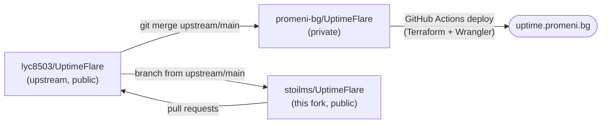

# UptimeFlare: Stoil Stoilov's contributions fork

This is my public fork of [lyc8503/UptimeFlare](https://github.com/lyc8503/UptimeFlare), the serverless uptime monitoring and status page built on Cloudflare Workers. I use it **only to contribute changes upstream**.

> This README is specific to the fork and is not meant for upstream. For the project itself (features, quick start, configuration), see the [upstream README](https://github.com/lyc8503/UptimeFlare#readme) and [wiki](https://github.com/lyc8503/UptimeFlare/wiki).

Maintained by **[Stoil Stoilov](https://stoilms.com)** · [stoilms.com](https://stoilms.com) · [LinkedIn](https://www.linkedin.com/in/stoilms) · [GitHub](https://github.com/stoilms)

## The setup

Two repositories, each with its own job:

- **The private repo, `promeni-bg/UptimeFlare`,** runs the live status page at **[uptime.promeni.bg](https://uptime.promeni.bg)**. It holds the deployment configuration, which stays private.
  - It shares git history with upstream, so updates are a normal `git merge upstream/main`.
  - New features are built and tested there first, behind optional settings.
  - Every merge to its `main` deploys to Cloudflare: Workers for the checks, D1 for state, Pages for the site.
- **This public fork** contains no deployment configuration. Each contribution is a branch cut from upstream `main`, carrying only the generic part of a change already running in production. Each one is opened as a pull request against upstream.

The fork's `main` matches upstream except for this README. Contribution branches never include it.

## Contributions

| Change | Upstream PR | Branch | Status |
|---|---|---|---|
| Fix "Uptimeflare" → "UptimeFlare" in the default footer | [lyc8503/UptimeFlare#225](https://github.com/lyc8503/UptimeFlare/pull/225) | `fix/footer-spelling` | Open |
| Configurable date/time display: fixed time zone, format patterns, time zone notice | [lyc8503/UptimeFlare#226](https://github.com/lyc8503/UptimeFlare/pull/226) | `feat/datetime-format` | Open |
| Server-rendered page metadata and footer, for search engines and link previews | Not opened yet | – | Planned, once search results are verified |

### Configurable date/time display ([#226](https://github.com/lyc8503/UptimeFlare/pull/226))
Optional `pageConfig.dateTime` setting:
- **Fixed time zone:** a fixed IANA zone for all visitors, or each visitor's local time (the default).
- **Format patterns:** moment-style patterns such as `D MMM YYYY [at] h:mm:ss A`, applied to the status page, the incidents page, the response-time charts and notifications.
- **Time zone notice:** an ⓘ icon next to "Last updated" always says which time zone the times are in. The notice is translated into all UI languages.

The formatter is dependency-free and built on `Intl`.

### Server-rendered metadata and footer (planned)
Upstream renders the whole app client-side (`NoSsr`), so search engines and link-preview crawlers get a page with no title, description, favicon or text. The fix:
- server-renders the `<head>` metadata: title, description, canonical URL, Open Graph/Twitter tags and site-name structured data, through an optional `pageConfig.meta`;
- server-renders the footer.

It has been live on [uptime.promeni.bg](https://uptime.promeni.bg) since October 2026. The upstream PR will follow once Google's search results confirm the improvement.

## Working on this fork

1. Keep `main` in sync with upstream **locally**: `git fetch upstream && git merge upstream/main`.
   - `.gitattributes` keeps this README on merges; run `git config merge.ours.driver true` once per clone.
   - GitHub's "Sync fork" button ignores that rule. If upstream has changed its README, the button reports a conflict and offers to discard this fork's commits. Don't accept; merge locally instead.
2. Cut each contribution branch from **upstream** `main`: `git checkout -b <branch> upstream/main`.
3. Bring in the change from the private repo, leaving out its `uptime.config.ts`, `README.md` and any site-specific assets. **Never push deployment configuration to this fork.**
4. Verify (lint, `tsc`, both builds, a local run), then open a draft PR against `lyc8503/UptimeFlare` and add it to the table above.

## License

UptimeFlare is licensed under the [Apache License 2.0](LICENSE). The changes in this fork's branches are offered upstream under the same license.
